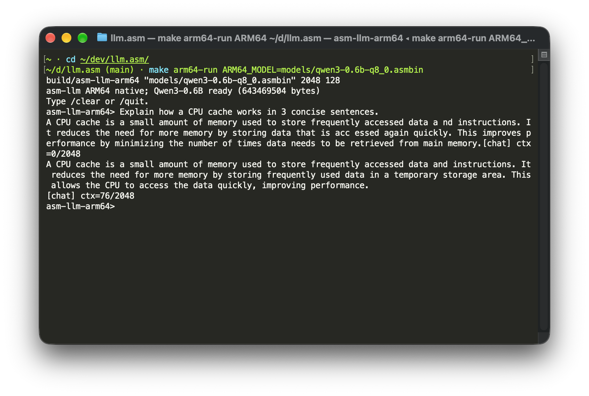

# Native ARM64 Qwen3-0.6B

This is an AArch64 port of the inference path in `01-qwen3-inference` and its
model/tokenizer formats. It consumes the same `.asmbin` exported by
`scripts/export_weights.py`, implements the same Q8_0 transformer and BPE
tokenizer, and uses ARM NEON integer dot products. It runs as a native macOS
process on Apple Silicon; it does not boot the x86 bare-metal OS in
`02-baremetal-os`.

## Build and run

Requirements: Apple Silicon macOS, Xcode command line tools, Python 3, and
NumPy. From the repository root, download and export the official Qwen3-0.6B
weights, then build and run:

```sh
python3 -m pip install numpy
./scripts/download_qwen3_06b.sh
make arm64
make arm64-run ARM64_MODEL=models/qwen3-0.6b-q8_0.asmbin
```

The executable starts an interactive multi-turn prompt. `/clear` resets the
context; `/quit` exits.
Optional Make variables: `ARM64_CTX` and `ARM64_TOKENS`.

Run evidence from Apple Silicon:



The original x86-64 targets and their bare-metal kernel remain separate.
